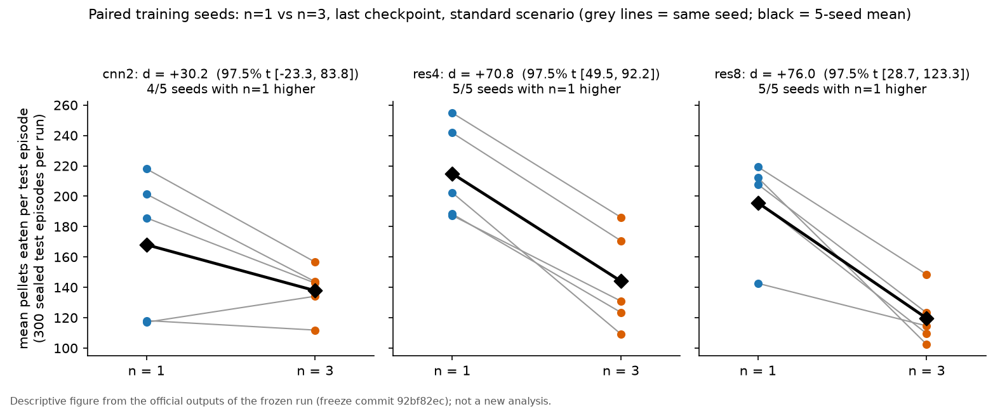
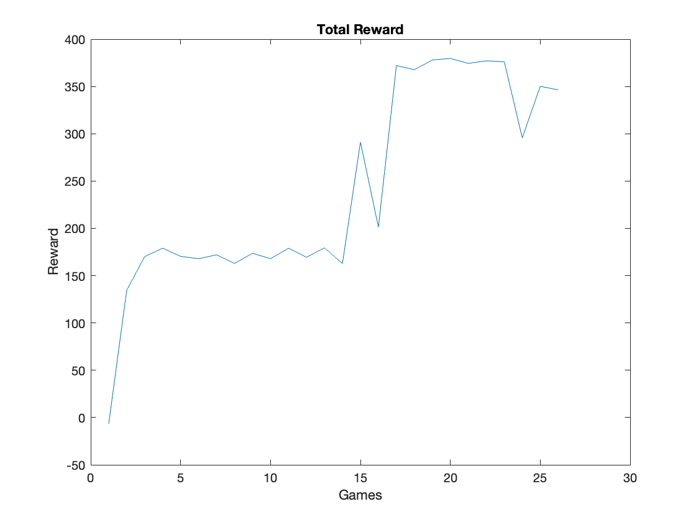
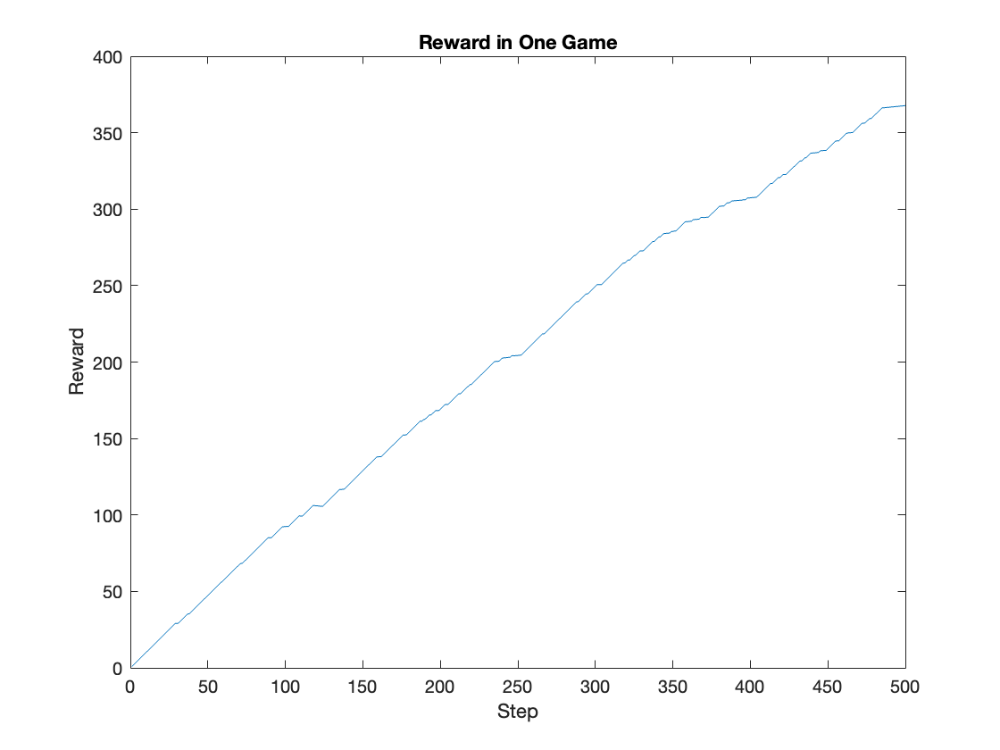

# Reinforcement-Learning-Pacman

A Pacman game written in Java (2023), a Python port of it used as a deep-reinforcement-learning test bed (2026), and a
preregistered study of how the n-step return length and the network architecture affect a DQN agent on that game.

Where to start
==============

| If you want ... | go to |
|---|---|
| the preregistered study and its result on one page | [docs/PREREG_RESULTS.md](docs/PREREG_RESULTS.md) |
| the frozen protocol and analysis specification (Chinese originals govern; English reading copies) | [docs/prereg/](docs/prereg/), [docs/translations/](docs/translations/) |
| the evidence made outside the repository (freeze record before training; results bundle) | GitHub releases `prereg-v0.3.2-r1-freeze-92bf82eca0da` and `prereg-v0.3.2-r1-results-92bf82eca0da` |
| to run the Python code and tests | [Python research platform](#python-research-platform-2026), [python/README.md](python/README.md) |
| the earlier exploratory experiments, plan and research log (English reading copies) | [docs/en/](docs/en/) |
| the original Java game, its videos and its 2023 training figures | [Original Java project (2023)](#original-java-project-2023) |

Preregistered study: n-step return x network architecture
=========================================================

**Question.** Does the n-step return length (n = 1 vs n = 3) change how well a DQN agent plays Pacman, and does the size
of that effect depend on the network architecture (a small CNN, a 4-block and an 8-block residual network)?

**Design.** One Pacman map, three architectures x n in {1, 3} x five paired training seeds = 30 runs of 300,000
environment transitions each, one frozen recipe. Primary endpoint: the last checkpoint, standard scenario, 300 sealed test
episodes per run. The protocol, the run matrix and the analysis specification were frozen and recorded outside the
repository before any formal run; the 30 runs were made once, the test set was opened once and the analysis was run once.

**Result** (mean pellets eaten per episode, 5 training seeds; d = n=1 minus n=3):

| architecture | n=1 | n=3 | d | 97.5 % t interval for d | seeds with d > 0 |
|---|---:|---:|---:|---|---:|
| cnn2 | 168.07 | 137.82 | +30.24 | [-23.35, 83.84] | 4/5 |
| res4 | 214.95 | 144.10 | +70.85 | [49.52, 92.18] | 5/5 |
| res8 | 195.66 | 119.65 | +76.01 | [28.74, 123.28] | 5/5 |

* **H1 supported**: on the 4-block residual network, n = 1 beats n = 3 by at least 10 points (estimate +70.85).
* **H2 uncertain**: the difference of the n-step effect between res8 and cnn2 is +45.77 with a 97.5 % interval of
  [-29.68, 121.21]; with five seeds the data cannot say whether the effect depends on the architecture.


More figures and captions: [docs/PREREG_RESULTS.md](docs/PREREG_RESULTS.md#9-figures-descriptive)

**What this does not show.** It is not a general statement that one-step returns beat three-step returns, nor that deeper
networks are better: one map, five training seeds, a privileged BFS distance-field input, a fixed 300,000-step budget and
unequal compute at equal budget. "Uncertain" is not "no interaction". Neither exploration strength nor off-policy
correction was manipulated, so no mechanism was tested; explanations proposed after seeing the data are post-hoc. The
reviews of the numbers (the local executor, GPT and DSH, all AI models or the executor) agree to the last digit; they are
not an independent human audit.

**Details, errata and limits**: [docs/PREREG_RESULTS.md](docs/PREREG_RESULTS.md).

**Verifying and re-running.** Everything needed to recompute the official outputs is in the results release (raw
evaluation files, official analysis outputs, process receipts). Formal runs are defined at the freeze commit
`92bf82eca0dae731f7396ed5b4e887e4f3b200e4`: use a fresh clone checked out at that commit, as described in
[docs/prereg/README.md](docs/prereg/README.md); numbers produced on other commits are not comparable with the frozen
run identity.


Python research platform (2026)
===============================
A Python port of this game plus a ladder of agents (random → hand-written rules → tabular Q-learning →
MLP / CNN / ResNet DQN) evaluated under one protocol now lives next to the original Java code, which is
unchanged.

* Start here: [`python/README.md`](python/README.md) (how to run, GPU notes), [`docs/PLAN.md`](docs/PLAN.md)
  (plan, acceptance gates, deviation log), [`docs/RESULTS.md`](docs/RESULTS.md) (auto-generated results and
  limitations), [`docs/ACCEPTANCE.md`](docs/ACCEPTANCE.md) (how to verify).
* The Java agent was re-run headless: with its default settings it scores about 160 pellets on average and
  dies in ~96 % of games. The 300+ scores in `data/Score.txt` come from other training states and do not
  represent that configuration.
* Headline (300 test games, standard ghosts): the best learned agent (an MLP on engineered features) clearly
  beats the Java agent. With 300k training steps (local GPU run) its mean is ~2 % below a careful hand-written
  planner and not significantly different from it, but equivalence or non-inferiority is *not* established (the
  confidence interval ignores training-seed variance); with 120k steps (cloud CPU run) it was ~12 % below.
  Deeper conv nets did *not* help at either budget under the default recipe; the one algorithmic finding that
  reproduced in a second run is that n-step = 1 helps the ResNet-4 a lot. (That run tested n-step = 1 only
  on ResNet-4; the preregistered study above tests it on three architectures.)
  See `docs/RESULTS.md` (cloud, 120k steps), `results_gpu/RESULTS.md` (local, 300k steps) and
  `docs/RESULTS_COMPARISON.md` (side by side, auto-generated) for numbers, ablations and caveats.
* Roles, working rules and the phase log: [`docs/RESEARCH_LOG.md`](docs/RESEARCH_LOG.md).
* Tooling for the preregistered architecture x n-step study (matrix, runner, sealed final evaluation, smoke runs): [`docs/prereg/README.md`](docs/prereg/README.md).

```
cd python && pip install -r requirements.txt && python -m pytest tests -q
bash scripts/acceptance.sh --quick
```


Original Java project (2023)
============================
The sections below are the original README of the 2023 Java project, kept as written. Their performance figures are
historical records of that project's own training and are not measurements of the work described above.

This a open-source project done by Firefade0329. Pacman is a well-known game since last century. 
This project includes a pacman game for human player, a AI controlled pacman game using path-finding algorithm, and an AI controlled pacman game trained by Reinforcement Learning.

Videos
======
The first video shows the AI before training. Pacman is randomly exploring.


[PreTrain.mov (before training)](Video/PreTrain.mov)


The second video shows the AI after training. Pacman is eating dots as fast as possible while keeping awway from the ghosts.


[Trained.mov (after training)](Video/Trained.mov)


Reinforcement Learning Performance
=================================
The first figure shows the total rewards gaied in each game. Pacman can get more rewards as the training process goes. After 18 games, it can mantain a reward between 300 and 400 each game.


The second figuer shows the rewards gained during a single game. Pacman is cumulating ots reward as quick as possible.


> Note added in 2026: the figures in this section come from the original 2023 Java training (`data/Reward.txt` has 22
> games, `data/Score.txt` 51 games, many of them degenerate low-scoring games late in the file). When the Java agent was
> re-run headless with its default settings (150 games, no seeds) it scored 160.5 pellets on average with a 96 % death
> rate; the 300+ scores in `data/Score.txt` do not represent that configuration (see [docs/en/RESULTS.en.md](docs/en/RESULTS.en.md)).


How to run
==========
To run game for human player
```
Run Pacman.java
```
To run pacman with Dijkstra pathfinding algorithm
```
Run PacmanDijkstra.java
```
To run Reinforcement Learning AI
```
Run PAcmanRL.java
```
Parameters for training such as learning factor, decay rate. radom rate can be set in
```
ReinforcementLearning/Qlearning.java
```
To train from start, set the following
```
train = true
keepTrain = false
readQ = false
```
To continue training from exsisting model, set
```
train = true
keepTrain = true
readQ = false
```
To load a traned model, set
```
train = false
keepTrain = false
readQ = true
```
