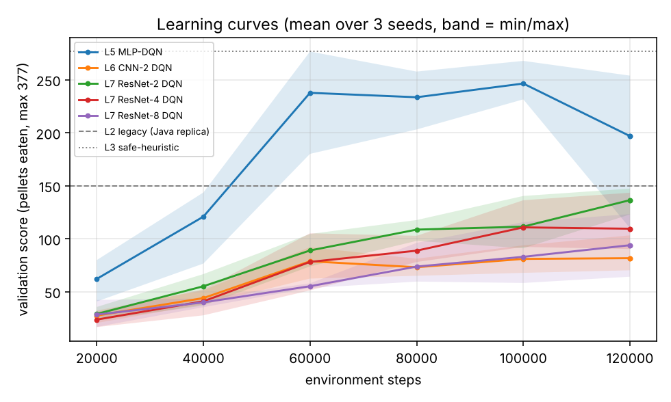
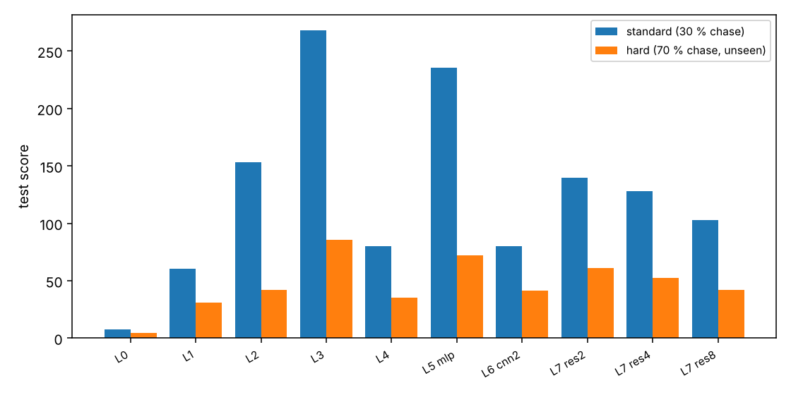

> This is a reading copy. The Chinese original (`docs/RESULTS.md`, SHA-256 `af92aeb01cc03191ceaccbc1a8f334661e4a12ffd29a957b7bb65cd052de72f2`, as of commit aa254a3) governs; in case of any difference the original governs.

# Experiment results (automatically generated from `results/` by `python/scripts/make_report.py`; do not edit by hand)

## 1. How to read this report
- **Score** = number of pellets eaten (0–377). **Death rate** = proportion of episodes that ended by being caught by a ghost. **Win rate** = all 377 eaten.
- All rows are evaluated on the same batch of **300 test seeds** (same starting points, so they can be compared pairwise); the RL rows are the per-episode average over 3 training seeds.
- The neural-network checkpoints are **selected using only the validation set (50 episodes, a different batch of seeds)**; the test set is used only in the final evaluation.
- Standard scenario: ghosts chase with 30% probability (original rules). Hard scenario: 70% chase, never seen during training.

## 2. Replication check against the original Java code
Original Java agent run headless (150 games, no seeds): mean score 160.5 [143.9, 177.4], death rate 96%.
The replica `legacy` shows **no significant difference detected** from it in the means of score, steps and death rate (z tests) and in the score distribution (KS test) (see `python/tests/test_baselines.py::test_legacy_replica_matches_original_java_run`). This is only a distribution-level test: the Java code has no random seed, so episodes cannot be compared one by one; differences such as terminal-state timing are in section 4 of `docs/PLAN.md`.
Note: the 300+ high-scoring episodes in `data/Score.txt` in the repository do not represent the true performance of this default configuration.

## 3. Standard scenario (test set, 300 episodes)
| agent | mean score [95% CI] | death rate | win rate | mean steps |
|---|---|---|---|---|
| L0 random | 7.5 [6.9, 8.1] | 100% | 0% | 41 |
| L1 greedy-BFS (no dodging) | 60.3 [54.9, 65.8] | 100% | 0% | 64 |
| L2 legacy (Java replica) | 153.4 [141.7, 165.4] | 95% | 5% | 247 |
| L3 safe-heuristic | 268.2 [254.9, 281.0] | 81% | 17% | 448 |
| L4 tabular Q (64 states) (mean of 3 seeds) | 80.3 [74.4, 86.4] | 100% | 0% | 96 |
| L5 MLP-DQN (mean of 3 seeds) | 235.7 [226.5, 244.9] | 79% | 21% | 345 |
| L6 CNN-2 DQN (mean of 3 seeds) | 80.3 [76.6, 84.0] | 100% | 0% | 110 |
| L7 ResNet-2 DQN (mean of 3 seeds) | 139.5 [134.2, 144.6] | 100% | 0% | 236 |
| L7 ResNet-4 DQN (mean of 3 seeds) | 127.8 [122.5, 133.1] | 100% | 0% | 202 |
| L7 ResNet-8 DQN (mean of 3 seeds) | 102.8 [98.2, 107.6] | 100% | 0% | 166 |

## 4. Hard scenario (test set, 300 episodes, not seen during training)
| agent | mean score [95% CI] | death rate | win rate | mean steps |
|---|---|---|---|---|
| L0 random | 4.3 [4.0, 4.6] | 100% | 0% | 18 |
| L1 greedy-BFS (no dodging) | 31.1 [28.6, 33.8] | 100% | 0% | 32 |
| L2 legacy (Java replica) | 42.2 [39.5, 45.0] | 100% | 0% | 60 |
| L3 safe-heuristic | 85.9 [79.0, 92.8] | 100% | 0% | 106 |
| L4 tabular Q (64 states) (mean of 3 seeds) | 35.4 [32.7, 38.2] | 100% | 0% | 42 |
| L5 MLP-DQN (mean of 3 seeds) | 72.2 [68.0, 76.6] | 100% | 0% | 90 |
| L6 CNN-2 DQN (mean of 3 seeds) | 41.6 [39.7, 43.5] | 100% | 0% | 47 |
| L7 ResNet-2 DQN (mean of 3 seeds) | 61.2 [58.3, 64.2] | 100% | 0% | 74 |
| L7 ResNet-4 DQN (mean of 3 seeds) | 52.6 [49.9, 55.2] | 100% | 0% | 63 |
| L7 ResNet-8 DQN (mean of 3 seeds) | 42.0 [39.6, 44.5] | 100% | 0% | 52 |

## 5. Per-seed results and ablations (standard scenario, test score)
| config | seed 0 | seed 1 | seed 2 | mean ± std over seeds | val score (selection) |
|---|---|---|---|---|---|
| L5 MLP-DQN | 246.1 | 241.3 | 219.7 | 235.7 ± 14.1 | 263.5 |
| L6 CNN-2 DQN | 98.0 | 67.2 | 75.6 | 80.3 ± 15.9 | 85.0 |
| L7 ResNet-2 DQN | 133.6 | 143.4 | 141.4 | 139.5 ± 5.2 | 142.2 |
| L7 ResNet-4 DQN | 153.3 | 102.3 | 127.8 | 127.8 ± 25.5 | 124.7 |
| L7 ResNet-8 DQN | 75.2 | 89.3 | 144.0 | 102.8 ± 36.3 | 93.8 |
| res4 -nodouble | 163.6 | 100.4 | 143.4 | 135.8 ± 32.3 | 133.2 |
| res4 -nodueling | 171.6 | 147.8 | 144.0 | 154.5 ± 15.0 | 148.2 |
| res4 -nstep1 | 210.8 | 197.5 | 163.3 | 190.5 ± 24.5 | 200.3 |
| res4 raw grid (no distance fields) | 112.5 | 77.5 | 96.3 | 95.4 ± 17.5 | 101.3 |
| mlp -nodouble | 253.2 | 235.0 | 245.9 | 244.7 ± 9.2 | 264.8 |
| mlp -nodueling | 246.7 | 257.5 | 260.2 | 254.8 ± 7.1 | 267.7 |
| mlp -nstep1 | 241.3 | 239.9 | 260.6 | 247.3 ± 11.6 | 246.2 |

Final agent (chosen among the 5 networks by validation score): **L5 MLP-DQN**

### Change of the ablations relative to the full recipe (paired, standard scenario)
| variant | baseline | score difference (variant − baseline) [95% CI] | per seed: number of seeds in which the variant is higher than the baseline |
|---|---|---|---|
| without Double | L7 ResNet-4 DQN | +8.0 [+0.5, +15.5] | 2/3 |
| without Dueling | L7 ResNet-4 DQN | +26.7 [+19.4, +34.1] | 3/3 |
| n-step=1 (n-step removed) | L7 ResNet-4 DQN | +62.7 [+54.8, +70.6] | 3/3 |
| raw grid (distance fields removed) | L7 ResNet-4 DQN | -32.4 [-38.7, -26.2] | 0/3 |
| without Double | L5 MLP-DQN | +9.0 [-1.1, +19.2] | 2/3 |
| without Dueling | L5 MLP-DQN | +19.1 [+10.0, +27.9] | 3/3 |
| n-step=1 (n-step removed) | L5 MLP-DQN | +11.6 [+1.7, +21.6] | 1/3 |

Note: "per seed" matches by seed number (the random initialisation and exploration trajectories of the different configurations are not the same, so this is only a rough directional consistency, not a strict pairing). The CI reflects only the sampling fluctuation of the test episodes and **does not include the differences between training seeds**; each cell has only 3 training seeds.

## 6. Curves




## 7. Acceptance-threshold verdicts (output of `check_acceptance.py --run-tests`)
```
M1  MUST   PASS      63 passed, 1 skipped
M2  MUST   PASS      each evaluated twice on 50 validation seeds (cpu): mlp_s0/best.pt: identical; res4_s0/best.pt: identical
M3  MUST   PASS      baselines random/greedy-bfs/legacy/safe-heuristic + tabular x3 seeds present
M4  MUST   PASS      final arch=mlp (chosen on val). score: diff +82.3 [95% CI +68.9, +95.7]; death (legacy - deep): diff +0.2 [95% CI +0.1, +0.2]; per-seed means [246.1, 241.3, 219.7] vs legacy 153.4
M5  MUST   PASS      score vs tabular: diff +155.3 [95% CI +146.3, +164.5]
M6  MUST   PASS      all required runs present: 300 test episodes on the fixed seeds in both scenarios, summaries, configs match run names, shared hyper-parameters identical
M7  MUST   PASS      no changes to Java sources / images / Q-table since base commit
S1  SHOULD FAIL      deep vs safe-heuristic: diff -32.5 [95% CI -46.2, -18.4]; relative -12.1% (pre-set point-estimate target >= -3%; this is not a non-inferiority test: CI lower bound -46.2 vs the -3% bound -8.0, non-inferiority shown: False)
S2  SHOULD PASS      res2 vs cnn2: diff +59.2 [95% CI +53.2, +65.3]
S3  SHOULD PASS      hard: deep vs legacy: diff +30.1 [95% CI +25.7, +34.4]
S4  SHOULD REPORTED  test score by depth {cnn2: 80.3, res2: 139.5, res4: 127.8, res8: 102.8}; monotone in depth: False

MUST gates: ALL PASS
```

## 8. Unmet items and limitations (the wording is determined by the data; numbers are in the tables above)
- **S1 not met**: the mean score of the final neural network (MLP) is more than 3% below that of the strong hand-written heuristic `safe-heuristic`; for the gap see section 7. "Writing the rules carefully" is still stronger.
- **Convolutional networks**: the mean scores of all convolutional networks are clearly lower than the MLP; no convolutional network has a mean score above `legacy`. Depth is not monotonically beneficial (S4). The conclusion "no benefit from depth" holds only for the training budget of this report (120000 environment steps/run) and this one set of hyperparameters; whether they were trained sufficiently has **not been tested by a convergence check** (the curves in section 6 are for reference only).
- **The default recipe may be suboptimal for convolutional networks**: all architectures share one set of hyperparameters (not tuned per architecture), and the ablation shows that removing n-step gives a clearly higher score on ResNet-4 (section 5); the cause is for now only a hypothesis (for example, the bias of bringing exploratory actions into the n-step return under ε-greedy exploration), **and it has not been verified by experiment**. Therefore "no benefit from depth" may partly come from the recipe, but **so far only the single depth point ResNet-4 has n-step = 1 data**, so the interaction between recipe and depth cannot be distinguished; this is only a hypothesis to be tested.
- **Robustness of the conclusions**: in the two mutually independent runs, the cloud CPU set and the local GPU set (same code, same seeds, same hyperparameters; the second was run after seeing the conclusion of the first; they are not independent implementations), only "removing n-step is beneficial for ResNet-4" and "the distance fields help" were reproduced; the effects of removing Dueling / Double have opposite signs and no choice should be made on this basis. See `docs/RESULTS_COMPARISON.md` (auto-generated) for details.
- **The input contains privileged information**: both the engineered features of the MLP and the distance fields of the convolutional networks are computed from the game's internal state (BFS distance); the raw-grid control shows that the distance fields help ResNet-4. The MLP performs best, most likely because its features directly give shortest-path information, rather than because "neural networks are better at this".
- **Hard scenario** (ghosts chase with 70% probability, not seen during training): the lowest death rate of any agent is 100%, almost all are caught, and only the number of pellets eaten before being caught can be compared; it cannot be said that any agent "learned to cope with strong chasing".
- **Only one map**: the random starting points provide state diversity, but generalisation to other maps cannot be claimed.
- **Limited statistical power**: 3 training seeds per configuration, and the per-episode CI does not contain the between-seed variance; comparisons with small gaps (for example ResNet-2 versus ResNet-4) should not be over-interpreted.
- **Compute and process**: CPU, single process, 120000 steps/run. During the process two convolutional runs were killed for lack of memory and re-run; `res8_s1` and `res8_s2` used the old float32 replay (equivalent to the uint8 replay to 1 ulp); after a virtual machine was suspended some runs were resumed from a breakpoint (see the deviation record in `docs/PLAN.md`). Runs that were resumed: res4_s0. Resumption is **not bit-for-bit equivalent**: the environment state and the pending n-step queue were not saved (at most 2 transitions lost per environment), new episodes use unused seeds, and the effect on the training distribution is not quantified; the `train_log.jsonl` of these runs may contain repeated/regressing rows (the weights and the summary are not affected). For the supplementary experiment with longer training on the GPU see `results_gpu/RESULTS.md` and `docs/RESULTS_COMPARISON.md`.
