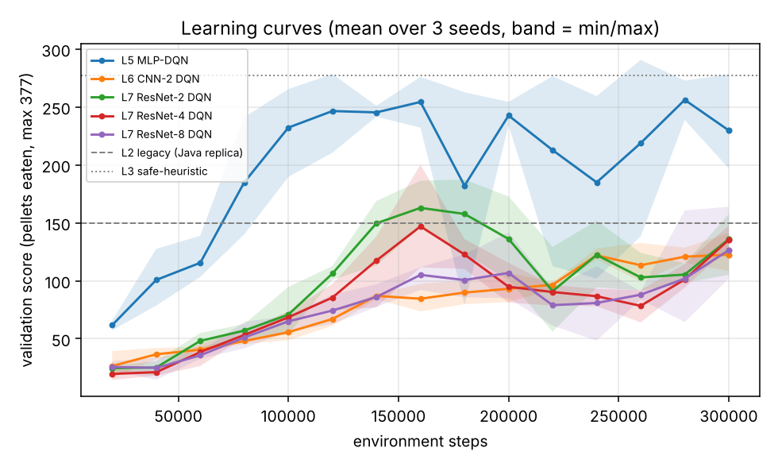
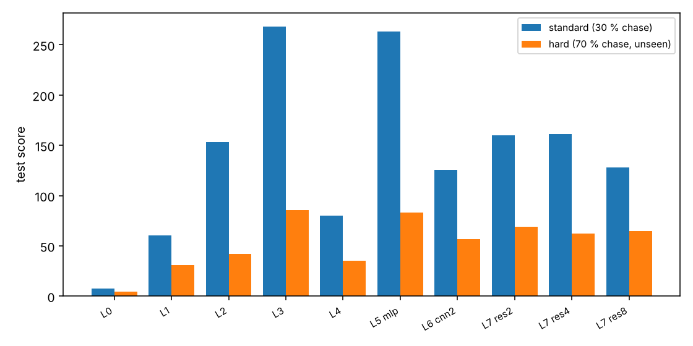

> This is a reading copy. The Chinese original (`results_gpu/RESULTS.md`, SHA-256 `1ddb0ccb86d9229fb36b193d75ced2797b6c8b0a3bf86b731b9b737b1dfe2f0c`, as of commit aa254a3) governs; in case of any difference the original governs.

# Experiment results (automatically generated from `results/` by `python/scripts/make_report.py`; do not edit by hand)

## 1. How to read this report
- **Score** = number of pellets eaten (0–377). **Death rate** = proportion of episodes that ended by being caught by a ghost. **Win rate** = all 377 eaten.
- All rows are evaluated on the same batch of **300 test seeds** (same starting points, so they can be compared pairwise); the RL rows are the per-episode average over 3 training seeds.
- The neural-network checkpoints are **selected using only the validation set (50 episodes, a different batch of seeds)**; the test set is used only in the final evaluation.
- Standard scenario: ghosts chase with 30% probability (original rules). Hard scenario: 70% chase, never seen during training.

## 2. Replication check against the original Java code
Original Java agent run headless (150 games, no seeds): mean score 160.5 [143.9, 177.4], death rate 96%.
The replica `legacy` shows **no significant difference detected** from it in the means of score, steps and death rate (z tests) and in the score distribution (KS test) (see `python/tests/test_baselines.py::test_legacy_replica_matches_original_java_run`). This is only a distribution-level test: the Java code has no random seed, so episodes cannot be compared one by one; differences such as terminal-state timing are in section 4 of `docs/PLAN.md`.
Note: the 300+ high-scoring episodes in `data/Score.txt` in the repository do not represent the true performance of this default configuration.

## 3. Standard scenario (test set, 300 episodes)
| agent | mean score [95% CI] | death rate | win rate | mean steps |
|---|---|---|---|---|
| L0 random | 7.5 [6.9, 8.1] | 100% | 0% | 41 |
| L1 greedy-BFS (no dodging) | 60.3 [54.9, 65.8] | 100% | 0% | 64 |
| L2 legacy (Java replica) | 153.4 [141.7, 165.4] | 95% | 5% | 247 |
| L3 safe-heuristic | 268.2 [254.9, 281.0] | 81% | 17% | 448 |
| L4 tabular Q (64 states) (mean of 3 seeds) | 80.3 [74.4, 86.4] | 100% | 0% | 96 |
| L5 MLP-DQN (mean of 3 seeds) | 263.3 [253.7, 272.9] | 70% | 30% | 398 |
| L6 CNN-2 DQN (mean of 3 seeds) | 125.5 [120.6, 130.3] | 100% | 0% | 174 |
| L7 ResNet-2 DQN (mean of 3 seeds) | 159.7 [154.1, 165.2] | 98% | 0% | 304 |
| L7 ResNet-4 DQN (mean of 3 seeds) | 160.9 [155.5, 166.4] | 100% | 0% | 270 |
| L7 ResNet-8 DQN (mean of 3 seeds) | 127.9 [122.0, 133.7] | 100% | 0% | 191 |

## 4. Hard scenario (test set, 300 episodes, not seen during training)
| agent | mean score [95% CI] | death rate | win rate | mean steps |
|---|---|---|---|---|
| L0 random | 4.3 [4.0, 4.6] | 100% | 0% | 18 |
| L1 greedy-BFS (no dodging) | 31.1 [28.6, 33.8] | 100% | 0% | 32 |
| L2 legacy (Java replica) | 42.2 [39.5, 45.0] | 100% | 0% | 60 |
| L3 safe-heuristic | 85.9 [79.0, 92.8] | 100% | 0% | 106 |
| L4 tabular Q (64 states) (mean of 3 seeds) | 35.4 [32.7, 38.2] | 100% | 0% | 42 |
| L5 MLP-DQN (mean of 3 seeds) | 83.1 [78.1, 88.2] | 100% | 0% | 106 |
| L6 CNN-2 DQN (mean of 3 seeds) | 56.9 [54.0, 59.7] | 100% | 0% | 64 |
| L7 ResNet-2 DQN (mean of 3 seeds) | 69.1 [65.6, 72.6] | 100% | 0% | 86 |
| L7 ResNet-4 DQN (mean of 3 seeds) | 62.1 [58.8, 65.5] | 100% | 0% | 74 |
| L7 ResNet-8 DQN (mean of 3 seeds) | 64.4 [61.2, 67.8] | 100% | 0% | 75 |

## 5. Per-seed results and ablations (standard scenario, test score)
| config | seed 0 | seed 1 | seed 2 | mean ± std over seeds | val score (selection) |
|---|---|---|---|---|---|
| L5 MLP-DQN | 266.3 | 252.6 | 271.2 | 263.3 ± 9.7 | 281.9 |
| L6 CNN-2 DQN | 109.8 | 125.8 | 140.8 | 125.5 ± 15.5 | 129.4 |
| L7 ResNet-2 DQN | 175.9 | 166.7 | 136.4 | 159.7 ± 20.7 | 173.3 |
| L7 ResNet-4 DQN | 142.8 | 149.0 | 191.0 | 160.9 ± 26.3 | 161.6 |
| L7 ResNet-8 DQN | 150.8 | 129.3 | 103.7 | 127.9 ± 23.6 | 129.5 |
| res4 -nodouble | 157.8 | 138.5 | 133.9 | 143.4 ± 12.7 | 155.0 |
| res4 -nodueling | 168.6 | 131.0 | 151.7 | 150.4 ± 18.8 | 165.4 |
| res4 -nstep1 | 241.7 | 216.5 | 242.1 | 233.4 ± 14.7 | 248.1 |
| res4 raw grid (no distance fields) | 139.2 | 109.6 | 121.4 | 123.4 ± 14.9 | 128.5 |
| mlp -nodouble | 267.1 | 270.1 | 267.8 | 268.3 ± 1.6 | 282.4 |
| mlp -nodueling | 254.5 | 246.5 | 258.1 | 253.1 ± 5.9 | 283.9 |
| mlp -nstep1 | 249.3 | 244.9 | 218.5 | 237.6 ± 16.7 | 255.6 |

Final agent (chosen among the 5 networks by validation score): **L5 MLP-DQN**

### Change of the ablations relative to the full recipe (paired, standard scenario)
| variant | baseline | score difference (variant − baseline) [95% CI] | per seed: number of seeds in which the variant is higher than the baseline |
|---|---|---|---|
| without Double | L7 ResNet-4 DQN | -17.5 [-25.1, -9.9] | 1/3 |
| without Dueling | L7 ResNet-4 DQN | -10.5 [-18.1, -2.9] | 1/3 |
| n-step=1 (n-step removed) | L7 ResNet-4 DQN | +72.5 [+64.3, +80.7] | 3/3 |
| raw grid (distance fields removed) | L7 ResNet-4 DQN | -37.5 [-44.7, -30.3] | 0/3 |
| without Double | L5 MLP-DQN | +5.0 [-4.3, +14.3] | 2/3 |
| without Dueling | L5 MLP-DQN | -10.3 [-20.0, -1.0] | 0/3 |
| n-step=1 (n-step removed) | L5 MLP-DQN | -25.8 [-36.9, -14.7] | 0/3 |

Note: "per seed" matches by seed number (the random initialisation and exploration trajectories of the different configurations are not the same, so this is only a rough directional consistency, not a strict pairing). The CI reflects only the sampling fluctuation of the test episodes and **does not include the differences between training seeds**; each cell has only 3 training seeds.

## 6. Curves




## 7. Acceptance-threshold verdicts (output of `check_acceptance.py --run-tests`)
```
M1  MUST   PASS      63 passed, 1 skipped
M2  MUST   PASS      each evaluated twice on 50 validation seeds (cpu): mlp_s0/best.pt: identical; res4_s0/best.pt: identical
M3  MUST   PASS      baselines random/greedy-bfs/legacy/safe-heuristic + tabular x3 seeds present
M4  MUST   PASS      final arch=mlp (chosen on val). score: diff +110.0 [95% CI +95.8, +123.9]; death (legacy - deep): diff +0.3 [95% CI +0.2, +0.3]; per-seed means [266.3, 252.6, 271.2] vs legacy 153.4
M5  MUST   PASS      score vs tabular: diff +183.0 [95% CI +173.4, +192.7]
M6  MUST   PASS      all required runs present: 300 test episodes on the fixed seeds in both scenarios, summaries, configs match run names, shared hyper-parameters identical
M7  MUST   PASS      no changes to Java sources / images / Q-table since base commit
S1  SHOULD PASS      deep vs safe-heuristic: diff -4.8 [95% CI -19.7, +10.5]; relative -1.8% (pre-set point-estimate target >= -3%; this is not a non-inferiority test: CI lower bound -19.7 vs the -3% bound -8.0, non-inferiority shown: False)
S2  SHOULD PASS      res2 vs cnn2: diff +34.2 [95% CI +26.7, +41.6]
S3  SHOULD PASS      hard: deep vs legacy: diff +40.9 [95% CI +35.7, +46.2]
S4  SHOULD REPORTED  test score by depth {cnn2: 125.5, res2: 159.7, res4: 160.9, res8: 127.9}; monotone in depth: False

MUST gates: ALL PASS
```

## 8. Unmet items and limitations (the wording is determined by the data; numbers are in the tables above)
- **S1 passes the preset point-estimate threshold, but equivalence/non-inferiority has not been established**: the difference in means is within -3% and the difference is not significant (the paired confidence interval in section 7 crosses zero), but the lower bound of the interval is below the -3% limit; the interval also does not contain the between-training-seed variance. This does not amount to "on par with the heuristic"; the MLP is not better than it.
- **Convolutional networks**: the mean scores of all convolutional networks are clearly lower than the MLP; the only convolutional networks whose mean score is higher than `legacy` are: ResNet-2 DQN, ResNet-4 DQN (whether the gap is significant is to be seen from the confidence intervals in section 3). Depth is not monotonically beneficial (S4). The conclusion "no benefit from depth" holds only for the training budget of this report (300000 environment steps/run) and this one set of hyperparameters; whether they were trained sufficiently has **not been tested by a convergence check** (the curves in section 6 are for reference only).
- **The default recipe may be suboptimal for convolutional networks**: all architectures share one set of hyperparameters (not tuned per architecture), and the ablation shows that removing n-step gives a clearly higher score on ResNet-4 (section 5); the cause is for now only a hypothesis (for example, the bias of bringing exploratory actions into the n-step return under ε-greedy exploration), **and it has not been verified by experiment**. Therefore "no benefit from depth" may partly come from the recipe, but **so far only the single depth point ResNet-4 has n-step = 1 data**, so the interaction between recipe and depth cannot be distinguished; this is only a hypothesis to be tested.
- **Robustness of the conclusions**: in the two mutually independent runs, the cloud CPU set and the local GPU set (same code, same seeds, same hyperparameters; the second was run after seeing the conclusion of the first; they are not independent implementations), only "removing n-step is beneficial for ResNet-4" and "the distance fields help" were reproduced; the effects of removing Dueling / Double have opposite signs and no choice should be made on this basis. See `docs/RESULTS_COMPARISON.md` (auto-generated) for details.
- **The input contains privileged information**: both the engineered features of the MLP and the distance fields of the convolutional networks are computed from the game's internal state (BFS distance); the raw-grid control shows that the distance fields help ResNet-4. The MLP performs best, most likely because its features directly give shortest-path information, rather than because "neural networks are better at this".
- **Hard scenario** (ghosts chase with 70% probability, not seen during training): the lowest death rate of any agent is 100%, almost all are caught, and only the number of pellets eaten before being caught can be compared; it cannot be said that any agent "learned to cope with strong chasing".
- **Only one map**: the random starting points provide state diversity, but generalisation to other maps cannot be claimed.
- **Limited statistical power**: 3 training seeds per configuration, and the per-episode CI does not contain the between-seed variance; comparisons with small gaps (for example ResNet-2 versus ResNet-4) should not be over-interpreted.
- **Compute and process**: a supplementary experiment on the GPU (300000 steps/run); for machine information, runs that were interrupted and resumed, memory scheduling and other process details see `LOCAL_RUN_REPORT.md` in the same directory. Runs that were resumed: mlp_s0, mlp_s1, mlp_s2, res4-nodouble_s0, res4-nodouble_s1. Resumption is **not bit-for-bit equivalent**: the environment state and the pending n-step queue were not saved (at most 2 transitions lost per environment), new episodes use unused seeds, and the effect on the training distribution is not quantified; the `train_log.jsonl` of these runs may contain repeated/regressing rows (the weights and the summary are not affected). Evaluation also depends on the device: results evaluated on the GPU and recomputed on the CPU differ episode by episode. For a side-by-side comparison with the cloud CPU set see `docs/RESULTS_COMPARISON.md`.
